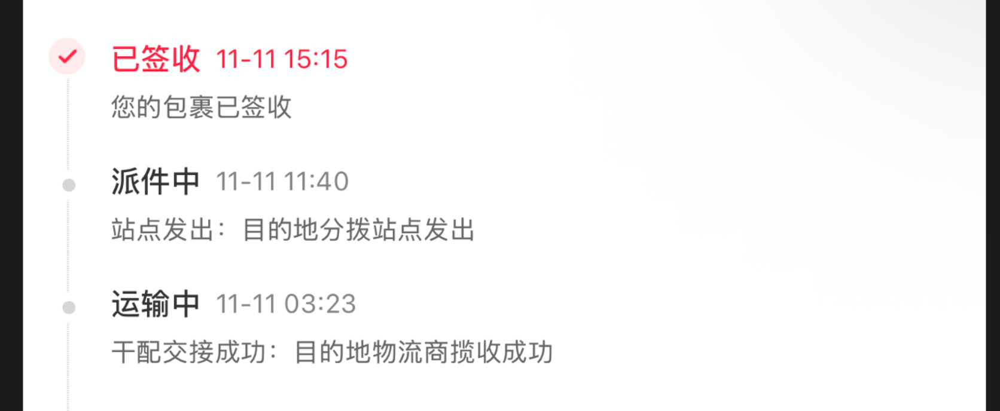
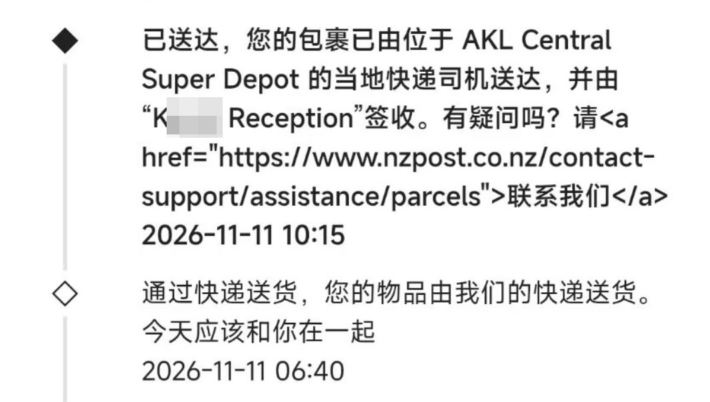

# 如果你不是抖M 请不要在境外通过小红书购买商品，因为这个平台就是世界上最不负责任的平台。


## 起因

对象在新西兰留学，在小红书上面购买了水晶项链（价值962CNY），从中国发往新西兰的奥克兰市。

承运对象为**菜鸟国际**，单号为CN0********513NZ

```
10-29 15:25 订单创建
```

```
10-29 22:29 商家发货
```
快递正式踏上旅途


```
10-29 22:29 到达江苏淮安
``` 

```
10-31 12:45 到达广东深圳
```

```
10-31 22:47 到达东莞，由 **广东东莞第三营业部**的快递员派送
```

```
10-31 23:08 由【APP集运仓】签收
```

```
11-11 15:15 最终在新西兰被签收
```

**BUT** 我的对象并**没有**拿到包裹，莫名其妙就被签收了，她住在公寓，去楼下找也没有找到任何消息，于是，包裹就这么丢了。

## 寻找包裹

包裹丢了自然是要寻找包裹。

在确认签收没有收到包裹后，我和我对象开始了寻找包裹之旅。

1. 首先我没有收到包裹
2. CN开头NZ结尾的快递单号在[菜鸟国际](https://gpn.cainiao.com/home)官网无法查询到任何信息，使用DeepSeek/GPT或者快递100/17track完全无法搜索到这个快递单号的任何信息

### 第一次分析

首先既然单号**无法找到**那就要找的真的单号才能联系到快递员，那么真的单号要如何获取呢？

答案是：无法通过自助方式获取任何单号（商家也不行）。小红书**默认**不给默认单号，CN开头NZ结尾的快递单号是小红书内部的快递单号。

于是找到了小红书客服和Redshop客服（负责海外购）。

首先，两个客服默认全部都是AI，没有任何作用！小红书客服可以通过12315的方式**威胁**从而转人工但是Redshop**完全**没有人工客服。

其次，客服的**无用**程度超乎了我的想象！

因为当小红书客服咨询过多，会用*很遗憾队长没有帮到您，队长已经帮您升级成功，预计24消失内会联系您沟通售后问题，请注意接听9501开头的来电*，来敷衍搪塞客户，实际上根本不会有**任何**电话打过来。

其次，需要用12315才能再次转接人工客服，不然全部都是 *24小时* 电话 。

再者，这个人工客服也是**一点用都没有**！

1. 没有权限获得外国段的快递单号
2. 推给我们去找菜鸟

好，那我问菜鸟：*这个单号查不到*

因为小红书给的是小红书的单号不是菜鸟的单号，我要去菜鸟查那我还要去找小红书要单号

小红书我操你妈逼！

对了，Redshop的客服也只会踢皮球，比小红书客服还要没有用，也就是说如果你是外国人的话，你的快件基本上就丢了。因为Redshop不会给你任何单号，真他妈神了小红书。

### 第二次分析

又回到了起点，寻找快递单号

我又一次找到了小红书官方客服，第一次，松了一点口说是**申通快递**。

我想，可能压根不是菜鸟国际，所以我打电话给申通，他妈的申通说这个格式根本就不是申通快递的。

小红书我操你妈！

然后我又找上了人工，这次人工终于有点脑子了，给了申通快递的单号（国内段），但是还是不给不了新西兰段的单号，因为小红书客服**没 有 权 限 ！**

~~我现在合理怀疑是因为小红书不想增加丢件沟通的成本所以才不给真实快递单号而使用他那个b小红书单号~~

至于Redshop客服，呃呃依旧路边一条。

所有我带着单号在快递100和申通国际查询，碰碰运气但是依旧只有国内的记录。

线索又断了....

最后我看到了那个【APP集运仓】。

```
10-31 23:08 由【APP集运仓】签收
```

这个集运仓是什么？（这时我已经差不多要排除了菜鸟国际承运的可能，也通过应用商店搜索了是否有个APP叫作“集运仓”，但是还是无果。至于为什么前面没有考虑到找申通客服，是因为当时我还没有从小红书客服拿到单号。）

于是我又找上了申通客服，问这个 APP集运仓 是哪个快递平台的集运仓。

答案是：菜鸟

没错，这个包裹就是走的菜鸟国际，但是小红书既没有告诉我原始单号，客服也没有第一时间告诉我国内段的单号，国外段单号更是滚木。他妈的小红书你死完全家了吗？

有了两个单号，我终于有点线索了。

于是我找到了菜鸟的客服。

依旧：*我们是国内的菜鸟只能查询国内的包裹哦*

再找了一次：*这个是小红书的单号呢请你在小红书咨询客服哦*

小红书我操你妈逼！又是你，你为什么一直不敢给客户真实单号呢？难道是为了让客户丢件你们不用承担损失让客户和商家承担吗？这是我见过最不服责任的平台。

然后，我找到菜鸟国际的官网，没有除了电话以外的联系方式，于是我又注意到了 【集运】二字。

这两个字是破案的关键，最终我通过检索检索到了 **菜鸟集运** 这是另外一个菜鸟的网站，从中找到了菜鸟的在线客服（这里菜鸟集运的APP下载链接是烂的，菜鸟集运小程序的客服也让我去找小红书 or 国内没有权限），但是经过弯弯绕绕的一堆事情，终于通过申通快递单号找到了对应新西兰段的单号。

拿到单号后：前者为小红书，后者为真实单号的信息





小红书隐瞒了这些信息

1. 我不知道是谁在新西兰承运
2. 我拿不到快递单号
3. 我不知道是谁签收的
4. 我不知道丢件了去联系谁

所以从头到尾都是小红书在隐瞒信息，阻碍客户找到包裹，同时也没有渠道给客户去解决问题。

小红书就是世界上最**垃圾**的电商平台。

至此我终于拿到了整个订单的完整信息：

1. 国内是申通发货
2. 由菜鸟国际承运
3. 由新西兰的NZPOST公司提供新西兰本地配送服务
4. 由Reception得知Kxx是一个酒店前台
5. 我可以通过NZPOST的工单找到送去的是哪一个酒店

这个 ```K Recetion```是破案的关键，对象认识的人刚好知道这个Kevin是谁，所以省去了第五步，直接找到了酒店拿到了快递。

# 如过你不是抖M，请不要在境外通过小红书购买商品，因为他为了减少扯皮会把所有客户应当知情的信息隐藏起来，包括最重要的你查询快递，联系快递员的方式：快递单号